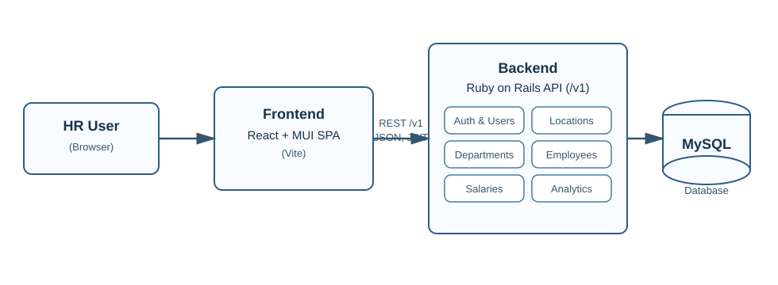
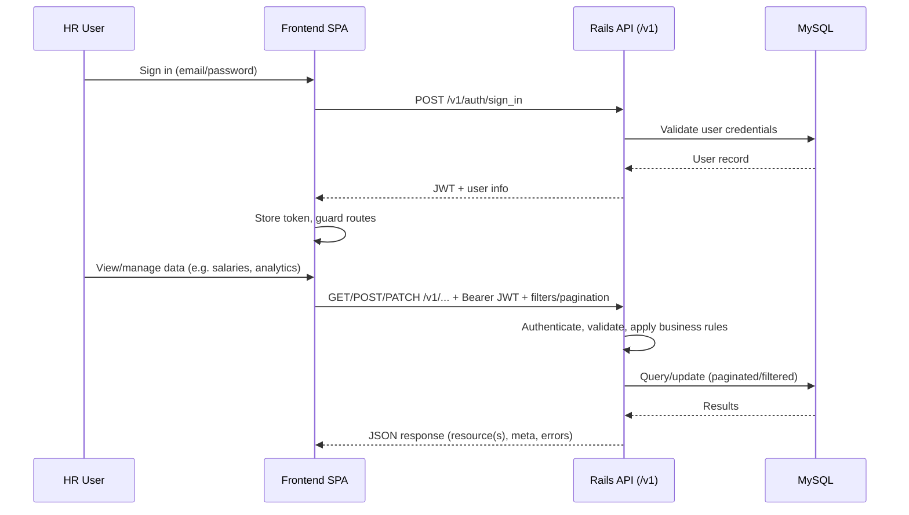
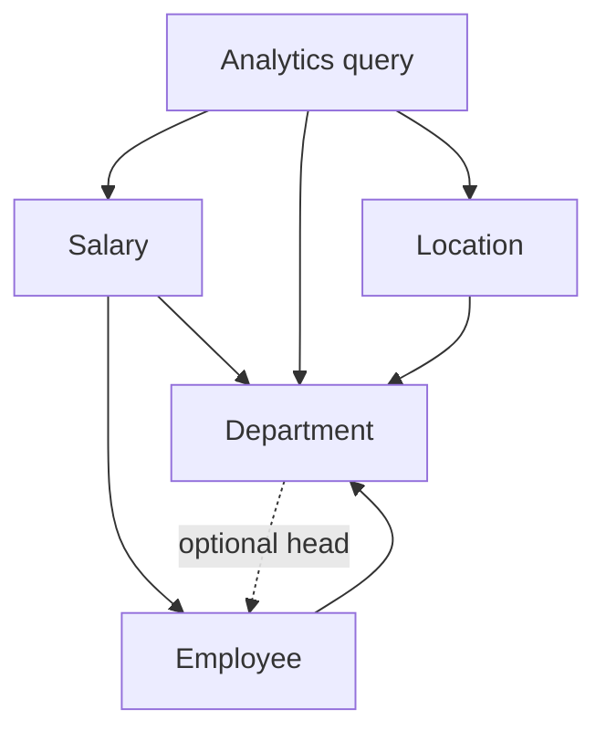

# Architecture

Salary Manager is an **HR-only web app** for managing employees, departments, locations, salary history, and analytics (designed for ~10k employees, multi-country/currency).

**Tech stack:** React + Vite + MUI (frontend), Ruby on Rails API (`/v1`, backend), MySQL (database), Devise + JWT (auth).

## 1. Overview



```text
HR User (Browser)
      |
      v
React + MUI SPA  --(REST /v1, JSON, JWT)-->  Rails API  -->  MySQL
  (frontend)                                  (backend)      (data)
```

**In short:** the frontend calls versioned JSON APIs, the backend enforces auth/business rules, and MySQL stores relational data. (A Mermaid overview is also included below in detailed views context where helpful; SVG/ASCII render everywhere.)

## 2. Detailed view: Request & auth flow



**Key points:** protected endpoints require a valid JWT; APIs use `page[number]/page[size]` and `filter[...]`; responses and errors follow consistent JSON shapes.

## 3. Detailed view: Backend modules & domain

```text
Rails API (/v1)
├─ Auth & Users        -> sign-in/out, password/invitation flows, HR provisioning
├─ Locations           -> city/state_code/country_code (validated, unique)
├─ Departments         -> belongs to Location, optional head employee
├─ Employees           -> belongs to Department (location via department)
├─ Salaries            -> belongs to Employee & Department
│                         components + server-derived total, currency,
│                         history/current period rules (no overlap, auto-close)
└─ Analytics           -> aggregates over current applicable salaries only
                          (per-currency, mixed-currency rejected)
```



**Key rules:** salary totals are server-derived; salary periods cannot overlap; creating a new open-ended salary closes the previous open one; analytics computes total/average/median for **current** salaries and requires a single currency in the filtered result.

## 4. Detailed view: Frontend structure

```text
frontend/src
├─ api/          -> client (JWT, base URL, errors) + resource modules
├─ auth/         -> session/token handling, guards
├─ components/   -> shared UI (DataTable, FilterBar, AsyncAutocomplete,
│                   PageHeader, DetailFields, ResourceState)
└─ pages/        -> auth, users, locations, departments, employees,
                    salaries, analytics (list/detail/create-edit views)
```

**Key points:** modular pages per domain, reusable table/filter/detail components, paginated & filterable lists, and dependent/typeahead inputs where useful (e.g. job title suggestions, country→state filters).

## 5. Detailed view: Runtime / deployment

```text
Local:
  Browser -> Frontend (Vite, :5173) -> Backend (Rails, :3000) -> MySQL (:3306)

Docker Compose:
  browser -> frontend container (:5173)
                 -> backend container (:3000) -> db container (MySQL, internal network)
  volumes persist db data / deps; backend prepares and seeds demo data on startup
```

**Key points:** frontend uses `VITE_API_BASE_URL` (default `http://localhost:3000/v1`); Docker setup provides an easy end-to-end demo environment with seeded HR user and ~10k employees.
